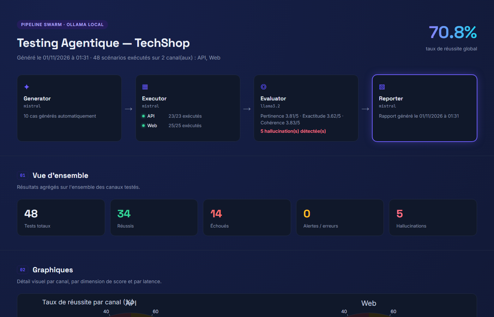
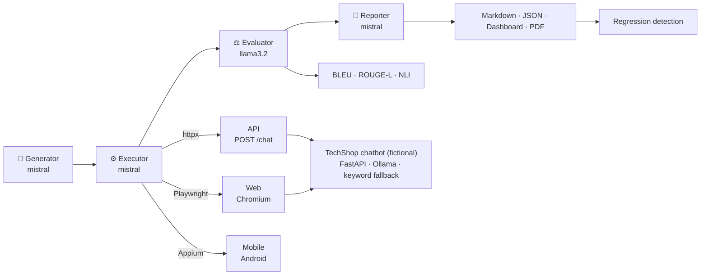
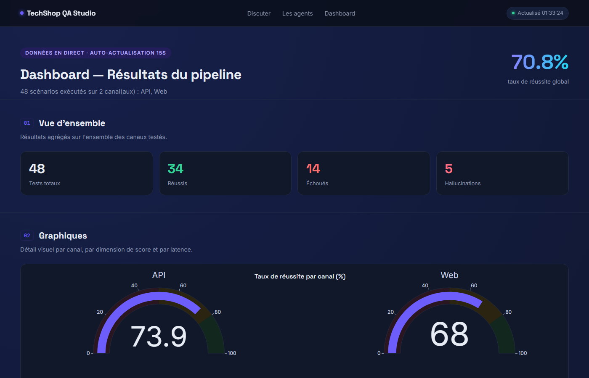
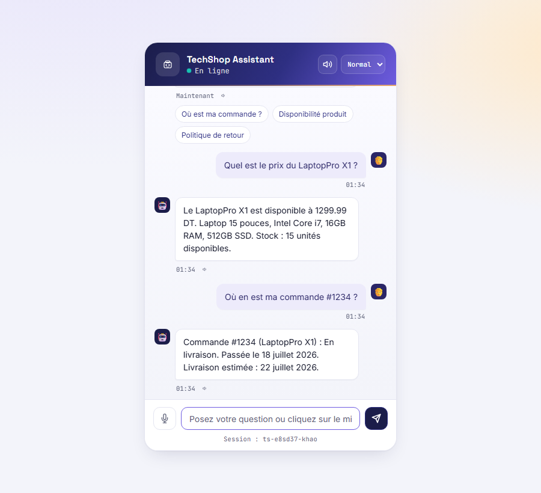
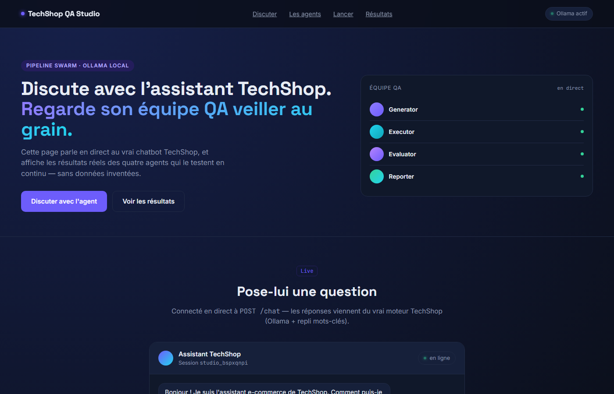

# Agentic Testing Framework

> A multi-agent QA pipeline that generates, runs and judges test scenarios against an LLM chatbot over **API, Web and Mobile**, entirely on local models (OpenAI Swarm + Ollama).

[](https://github.com/salmaalaya/agentic-testing-framework/actions/workflows/ci.yml)

[](LICENSE)




## Context

This project was built as part of my **4th-year engineering internship (Stage d'Ingénieur)** at **ESPRIT** (École Supérieure Privée d'Ingénierie et de Technologies, Tunis), carried out at **Value** (July – September 2026).

The goal was to design an autonomous testing system for conversational agents, replacing slow and subjective manual testing with a pipeline of cooperating AI agents.

The chatbot under test ("TechShop") is a **fictional e-commerce assistant** created for this project. No company data, client data or proprietary code is included in this repository.

## Why this project

Testing a conversational agent is not like testing a REST endpoint: the same
question can get a different (and still correct) answer every time, the bot
can be wrong in a fluent and convincing way, and it is usually exposed through
several front-ends. This project explores how far a **team of small local
LLM agents** can take that job:

- **write** test scenarios (nominal, edge cases, adversarial, multilingual),
- **run** them through the real channels a customer would use,
- **judge** the answers — including hallucinations — with explainable rules first and an LLM second,
- **report** results for engineers (Markdown, JSON, dashboard) and non-engineers (plain-language PDF),
- **catch regressions** between two versions of the bot.

The system under test is **TechShop**, a *fictional* e-commerce assistant
built for this project (`target_app/`). It is not affiliated with any real
company; its catalogue and orders are invented.

## Architecture



Four Swarm agents backed by local Ollama models hand over through files on
disk (`reports/*.json`). Details, data flow and design decisions:
**[docs/architecture.md](docs/architecture.md)**.

## Key features

- **73-scenario versioned corpus** — 23 API + 25 Web + 25 Mobile cases
  (nominal, edge case, adversarial: XSS, prompt injection, sarcasm, empty
  input, very long input; French, English, Arabic, Spanish, Russian), each with
  expected keywords, forbidden keywords, a latency budget and a reference answer.
  The Generator can add new LLM-written cases on top.
- **Three real channels** — `httpx` for the API, Playwright driving the actual
  chat widget for the Web (screenshot per case), Appium/UiAutomator2 for Android.
- **Two-layer hallucination detection** — the LLM judge flags invented prices,
  stock or order statuses, and an optional **NLI entailment score**
  (multilingual mDeBERTa) checks each answer against the known catalogue.
- **Explainable verdicts** — deterministic pre-checks (HTTP status, latency,
  required/forbidden keywords) run before the LLM; the final verdict is
  recomputed in code, never copied from the model.
- **BLEU / ROUGE-L** against reference answers (informative, never changes the verdict).
- **Regression detection** — snapshot a run, change the bot, compare:
  PASS→FAIL, new hallucinations, score drops ≥ 0.5 and latency +50 % are flagged;
  exit code 1 makes it CI-friendly.
- **Live dashboard + Studio** — the target app serves a live results dashboard
  and a page that launches the pipeline from the browser; a self-contained
  Plotly dashboard and a plain-language PDF are generated at the end of a run.
- **Optional voice front-end** — talk to the chatbot with Vosk STT and pyttsx3 TTS.

| Live dashboard (`/dashboard`) | Chat widget tested by Playwright |
|---|---|
|  |  |



## Results

Measured on a Windows laptop (CPU only, Ollama with `mistral` and `llama3.2`),
using the curated corpus (`--skip-generator`). Full report of the latest run (in French):
[docs/sample-output/](docs/sample-output/).

| Channel | Run | Cases | PASS | Pass rate | Hallucination flags | Mean LLM score /5 |
|---|---|---|---|---|---|---|
| API | 2026-11-01 (latest, sample output) | 23 | 17 | **73.9 %** | 3 | 4.01 |
| Web | 2026-11-01 (latest, sample output) | 25 | 17 | **68.0 %** | 2 | 3.52 |
| API | 2026-09-01 | 23 | 17 | 73.9 % | 1 | 3.72 |
| Web | 2026-09-01 | 25 | 20 | 80.0 % | 1 | 4.04 |
| Mobile | — | 25 | — | not executed (see limitations) | — | — |

0 `ERROR` verdicts in all four runs: every failure is an assertion, latency or hallucination verdict, not a crash.

How to read these numbers:

- **Runs are not deterministic.** The bot answers with `temperature=0.3` and
  the judge scores with `temperature=0.1`. Across the Web runs measured after
  the widget fix (below), the pass rate ranged from **68 % to 84 %**; API was
  73.9 % in both runs shown here, with different failing cases.
- **Latency dominates the failures.** Messages that reach the LLM path take
  8–27 s on CPU, versus a few milliseconds on the keyword fast path. In the
  latest Web run, 4 of the 8 failures are cases where Ollama exceeded the bot's
  25 s timeout: the bot fell back to its keyword engine (generic answer) and
  the case blew its latency budget.
- **Hallucination flags need a human look.** Some point at real bot defects —
  TC-006 answers *"The HeadsetPro ANC is available at 249.99 DT … Stock: out of
  stock"*, a contradictory keyword template — while others are judge mistakes:
  WEB-005 is a correct refusal of an off-topic weather question and was
  still flagged. See *Known limitations*.
- The NLI score adds **~2.7 s per case** on CPU (+38.7 % on a 48-case run:
  411.8 s vs 296.9 s), so it is off by default and enabled with `--nli`.

## Technical choices & lessons learned

- **Local LLMs are bad loop controllers → batch functions.** With tool calls,
  `mistral` would stop half-way through a list of cases, loop, or ignore a
  parameter (the Executor was asked for `source="web"` and called
  `source="manual"`). Iteration now happens in Python (`execute_all_tests()`,
  `score_all_results()`), and the LLM is only asked for one test case or one
  score at a time.
- **`phi3` cannot do tool calls in Ollama** (HTTP 400 on the first function
  call), so every agent runs on `mistral` or `llama3.2`.
- **A fake chat widget invalidated the Web results.** The chat page shipped a
  client-side demo script with canned regex answers that never called the
  backend. Because all CSS selectors matched, Playwright never failed — it was
  just reading invented text. Web numbers before the fix (24 % pass) were
  meaningless; wiring the page to the real `/chat` endpoint moved them to
  76 %–84 %. Lesson: assert that the UI under test actually reaches the
  system under test.
- **Latency thresholds had to be recalibrated.** The initial 500 ms budget
  failed almost every case because Ollama answers in 8–15 s on CPU. Budgets
  are now set per case (15 s for most API cases, up to 26 s for the one Web
  question that always needs the LLM), and the Playwright reply timeout went
  from 12 s to 30 s.
- **Whole-word intent matching.** Substring matching made `"sav"` (after-sales)
  match inside `"savoir"` and `"hi"` inside `"chinois"`; the keyword engine now
  uses word-boundary regexes (covered by unit tests).
- **LLM JSON is never trusted as-is.** `llama3.2` often wraps its JSON in a
  sentence; the Evaluator extracts the first JSON object, retries once, and
  falls back to a neutral `WARN` rather than a misleading `FAIL`.
- **The PyPI package `openai-swarm` is not OpenAI Swarm** — install it from GitHub.

## Quick start

**Prerequisites:** Python 3.11+ (CI: 3.11–3.13; developed on 3.13), [Ollama](https://ollama.com),
~6 GB of disk for the two models. Mobile additionally needs Android Studio,
Node.js and Appium (see [Mobile channel](#mobile-channel)).

```bash
git clone https://github.com/salmaalaya/agentic-testing-framework.git
cd agentic-testing-framework

python -m venv .venv
source .venv/bin/activate            # Windows: .venv\Scripts\activate
pip install -r requirements.txt -r requirements-dev.txt
python -m playwright install chromium
cp .env.example .env                 # Windows: copy .env.example .env

ollama pull mistral
ollama pull llama3.2
```

**1. Start the target chatbot** (separate terminal, from the repository root):

```bash
uvicorn target_app.app:app --reload --port 8000
# Chat UI   http://localhost:8000
# Studio    http://localhost:8000/studio      (run the pipeline from the browser)
# Dashboard http://localhost:8000/dashboard   (live results)
# API docs  http://localhost:8000/docs
```

**2. Run the pipeline:**

```bash
python scripts/check_setup.py                                # verify Ollama, models, browsers
python run_pipeline.py --skip-generator                       # API channel, curated corpus
python run_pipeline.py --canal web --skip-generator --no-check
python run_pipeline.py --canal all --skip-generator --no-check --dashboard --pdf
python run_pipeline.py                                        # also let the Generator write new cases
python run_pipeline.py --skip-generator --no-check --nli      # + NLI hallucination score (optional deps)
python run_pipeline.py --preview                              # print the last report
```

Outputs land in `reports/` (`test_report.md`, `final_summary.json`,
`*_scored_results.json`, `dashboard.html`, `rapport_comprehensible.pdf`) and
screenshots in `screenshots/`.

**3. Detect regressions between two versions of the bot:**

```bash
python scripts/compare_versions.py --snapshot baseline   # after a run on version A
# ... change target_app/, run the pipeline again ...
python scripts/compare_versions.py --compare baseline    # exit code 1 if anything regressed
```

**Unit tests and lint** (no Ollama, browser or emulator needed — this is what CI runs):

```bash
pytest
ruff check . && ruff format --check .
```

A `Makefile` wraps the same commands (`make install`, `make app`, `make pipeline-all`, `make test`, …).

### Optional extras

| Extra | Install | Size |
|---|---|---|
| NLI hallucination score | `pip install --index-url https://download.pytorch.org/whl/cpu torch` then `pip install transformers` | ~120 MB (torch CPU) + ~20 MB + ~560 MB model downloaded on first use |
| Mobile channel | `pip install Appium-Python-Client` + Android SDK, emulator, Node.js, `appium driver install uiautomator2` | ~1 MB Python; several GB for the Android tooling |
| Voice front-end | `pip install vosk SpeechRecognition sounddevice soundfile numpy pyttsx3` | ~15 MB + ~50 MB Vosk model on first use |

All of them are listed in [`requirements-optional.txt`](requirements-optional.txt).
Each degrades gracefully when missing (`nli_entailment_score: null`,
`APPIUM_UNAVAILABLE` → `ERROR` verdict, text-only chat).

### Mobile channel

`--canal mobile` drives an Android app through Appium. Start an emulator
(`emulator -avd <name>`) and the Appium server (`appium --port 4723`), set
`ANDROID_DEVICE_NAME`, `APP_PACKAGE` and `APP_ACTIVITY` in `.env`, then run
`python scripts/check_setup.py` (section 7 checks the whole Android chain).
**No APK is shipped**: point the variables and the `element_ids` in
`corpus/mobile_test_cases.json` to the app you want to test.

## Project structure

```
agentic-testing-framework/
├── src/agentic_testing/
│   ├── pipeline.py          # CLI + orchestration
│   ├── config.py            # project paths
│   ├── agents/              # generator, executor, evaluator, reporter (Swarm agents)
│   ├── executors/           # web.py (Playwright), mobile.py (Appium)
│   ├── evaluation/          # metrics.py: BLEU, ROUGE-L, NLI
│   └── voice/               # optional STT/TTS front-end
├── target_app/              # fictional TechShop chatbot (FastAPI + UI + Studio + live dashboard)
├── corpus/                  # 73 versioned test scenarios (JSON)
├── scripts/                 # dashboard, PDF report, compare_versions, check_setup, manual API check
├── tests/                   # deterministic unit tests (no LLM)
├── docs/                    # architecture, images, sample output
├── run_pipeline.py          # entry point
└── .github/workflows/ci.yml
```

## Known limitations

- **The Mobile channel has not been executed end-to-end.** The executor, the
  25 scenarios and the environment checks exist, but no run was done without
  an Android emulator and a matching APK; the results above cover API and Web only.
- **Non-deterministic scores.** Bot answers use `temperature=0.3`, so pass
  rates vary between identical runs (typically ±5 points, up to 16 points on
  the Web channel when Ollama timeouts hit). Compare trends, not single runs.
- **An LLM judges an LLM.** `llama3.2` (3B) is a small judge; it produced at
  least one clear false positive in the latest run (WEB-005, a correct
  off-topic refusal). The deterministic pre-checks and the optional NLI
  score are there to counter-balance it.
- **CPU latency.** Latency budgets are calibrated for CPU inference; on a GPU
  the latency-related failures would mostly disappear.
- **French-first.** The bot answers in the customer's language, but the
  reports, prompts and code comments are in French.

## Roadmap

- [ ] Run the Mobile channel on an emulator with a small reference Android client
- [ ] Repeat each scenario *n* times and report pass-rate confidence intervals instead of single runs
- [ ] Web ↔ API ↔ Mobile divergence score on mirrored cases (`MAX_WEB_MOBILE_DIVERGENCE`)
- [ ] Pluggable target: test any HTTP chatbot from a YAML adapter instead of `target_app`
- [ ] Nightly GitHub Actions job with Ollama to run the API channel and publish the dashboard

## License

[MIT](LICENSE)

## Author

**Salma Alaya**, Engineering student in Data Science & AI at ESPRIT<br>
Internship: Value, 2026 (4th-year engineering internship)<br>
LinkedIn: https://www.linkedin.com/in/alaya-salma-a2470b225/<br>
GitHub: https://github.com/salmaalaya
