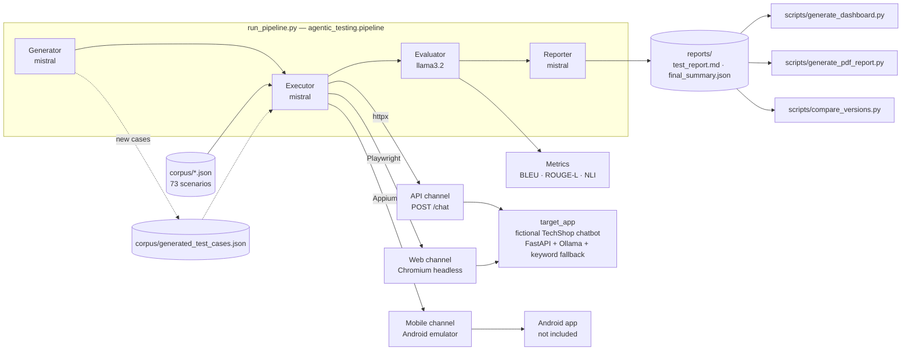

# Architecture

This document describes how the pipeline is wired, what each agent owns, and
which files flow between stages. For setup and results, see the
[README](../README.md).

> Built during a 4th-year engineering internship (ESPRIT), carried out at
> Value (July – September 2026). The chatbot under test, TechShop, is
> fictional: no company data, client data or proprietary code is included.

## Overview

All four agents are declared as OpenAI Swarm `Agent` objects backed by local
Ollama models through its OpenAI-compatible endpoint. In practice the
orchestration is done in plain Python (see *Design decisions* below): the LLM
is only asked to produce content — one test case, or one score — never to
route control flow.

## Package layout

| Path | Role |
|---|---|
| `src/agentic_testing/pipeline.py` | CLI and orchestration (Generator → Executor → Evaluator → Reporter) |
| `src/agentic_testing/agents/generator.py` | Builds a spec from the catalogue, asks `mistral` for **one** test case at a time, validates, repairs and de-duplicates it |
| `src/agentic_testing/agents/executor.py` | Loads a corpus and runs every case on the requested channel; API calls use a persistent `httpx.Client` |
| `src/agentic_testing/executors/web.py` | Playwright driver: types into the real chat widget, waits for the bot bubble, takes a screenshot |
| `src/agentic_testing/executors/mobile.py` | Appium (UiAutomator2) driver: login flow, gestures, chat, screenshots |
| `src/agentic_testing/agents/evaluator.py` | Deterministic pre-checks, then LLM scoring (relevance, accuracy, coherence, hallucination) |
| `src/agentic_testing/evaluation/metrics.py` | BLEU / ROUGE-L against a reference answer, optional NLI entailment score |
| `src/agentic_testing/agents/reporter.py` | Markdown report + JSON summary across channels |
| `src/agentic_testing/voice/` | Optional speech-to-text / text-to-speech front-end for the chatbot |
| `src/agentic_testing/config.py` | Single source of truth for `corpus/`, `reports/`, `screenshots/` paths |
| `target_app/` | The system under test: a **fictional** e-commerce chatbot (FastAPI), its chat UI, the Studio page and the live dashboard |
| `scripts/` | Stand-alone tools: dashboard, PDF report, regression detection, environment check, manual API check |

## Data flow

| File | Written by | Read by |
|---|---|---|
| `corpus/test_cases.json` (23 API) | hand-written | Executor |
| `corpus/web_test_cases.json` (25 Web) | hand-written | Web executor |
| `corpus/mobile_test_cases.json` (25 Mobile) | hand-written | Mobile executor |
| `corpus/generated_test_cases.json` | Generator | Executor |
| `reports/{,web_,mobile_}execution_results.json` | Executor | Evaluator |
| `reports/{,web_,mobile_}scored_results.json` | Evaluator | Reporter, dashboard, PDF, compare_versions |
| `reports/test_report.md`, `reports/final_summary.json` | Reporter | humans, live dashboard |
| `reports/snapshots/<name>/` | `compare_versions.py --snapshot` | `compare_versions.py --compare` |

## Evaluation logic

1. **Deterministic pre-checks** (`deterministic_precheck`) run first and
   short-circuit the LLM: execution errors, HTTP status ≥ threshold, latency
   above the case budget, empty answer, missing required keywords
   (`contains`, `contains_all`, `contains_any`) and forbidden keywords
   (`not_contains`, e.g. `<script>` for XSS cases).
2. **LLM scoring** (`llama3.2`, `temperature=0.1`): relevance, accuracy and
   coherence on 1–5, plus a boolean hallucination flag. The JSON is extracted
   even when the model wraps it in prose, and the call is retried once.
3. **Verdict is recomputed in code**: `FAIL` if `hallucination` is true or the
   mean score is below `MIN_SCORE_PASS` (3.0) — whatever verdict the LLM wrote.
4. **Informative metrics** never change the verdict: BLEU and ROUGE-L against
   `expected.reference_response`, and — with `--nli` — an entailment score of
   the answer against the known catalogue/orders
   (`MoritzLaurer/mDeBERTa-v3-base-mnli-xnli`, multilingual).

## Target application

`target_app/app.py` is a hybrid engine:

- **Fast path** — keyword intent detection with whole-word regex matching
  (`(?<!\w)kw(?!\w)`), used when the message is unambiguous (greeting,
  order number, a catalogue product). Answers in a few milliseconds.
- **LLM path** — Ollama (`mistral`) with a strict system prompt and a JSON
  answer format for ambiguous, multilingual or sarcastic messages.
- **Fallback** — if Ollama fails or times out, the keyword engine answers.

It also serves the chat UI (`/`), the Studio page to launch the pipeline from
the browser (`/studio`), and a live dashboard (`/dashboard`) fed by
`/api/pipeline-stats` and `/api/pipeline-details`.

## Design decisions

- **Code-based, not tool-based, channel automation.** One LLM call per
  scenario at most; Playwright/Appium steps are plain code, so runs are
  replayable and diffable in git.
- **Batch functions instead of LLM loops.** Local models looped or dropped
  items when asked to iterate over many cases via tool calls, and sometimes
  ignored parameters such as `source="web"`. `execute_all_tests()` and
  `score_all_results()` do the iteration in Python; the agents keep a single
  entry point each.
- **One generated case per LLM call.** Asking `mistral` for ten cases in one
  JSON payload was the main source of broken output; the Generator now asks
  for one case at a time with up to three attempts each.
- **Graceful degradation.** NLI, Appium and voice are optional: missing
  dependencies produce `None`/`ERROR`/`WARN` results instead of crashes.
